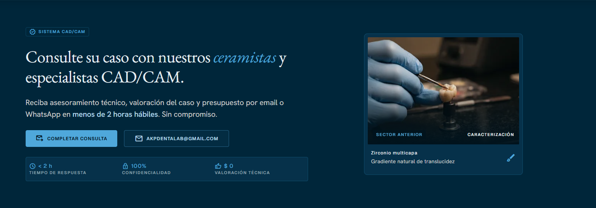
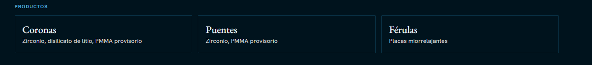
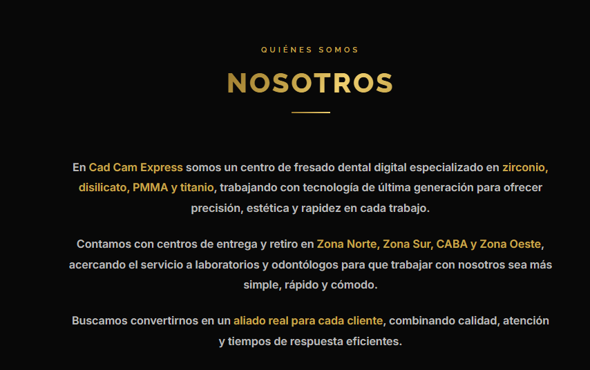
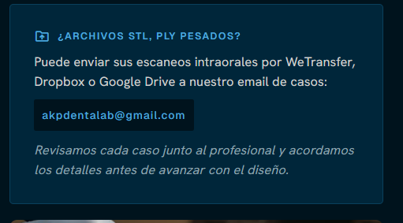
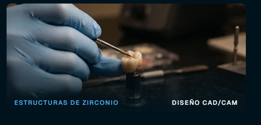

# Cambios solicitados en la web

1. **Logo:** debe quedar en formato horizontal (se adjuntará el archivo).

2. **Fondo:** todo el sitio debe tener fondo celeste suave (`#B9D9EB`).

3. **Header:**
   - Cambiar "Quiénes somos" por **"Nosotros"**.
   - Eliminar la sección **FAQ**.
   - El texto del botón "Enviar caso" debe ser **"SOLICITAR PRECIOS"**.

4. **Eliminar** la sección que dice:
   > Recepción de casos activa / STL · PLY · OBJ · Casos de todo el mundo por email / Respuesta en menos de 2 h

5. **Eliminar** la sección completa:

   

6. **Tipografía:** el título **"SISTEMA CAD/CAM"** debe tener el mismo tamaño que **"Qué fabricamos y con qué materiales"**.

7. **Eliminar** esto:

   

8. **`about.js`:** debe pasar a formato vertical, como en esta referencia:

   

   Contenido:

   > ### Nosotros
   >
   > **Un laboratorio dental digital, cerca del profesional**
   >
   > AKP Digital Dental Lab es un laboratorio dental digital dedicado a la fabricación de restauraciones protésicas mediante flujo CAD/CAM. Trabajamos junto a odontólogos, prostodoncistas, clínicas y protesistas que buscan precisión, previsibilidad y una comunicación técnica directa.
   >
   > Recibimos escaneos intraorales y archivos STL, PLY y OBJ desde cualquier lugar, diseñamos cada caso de forma digital y lo fabricamos con materiales de uso odontológico, cuidando el ajuste, la anatomía y la estética de cada pieza.
   >
   > Creemos que un buen resultado empieza antes del fresado: por eso revisamos cada caso junto al profesional, consultamos lo que haga falta y acordamos los detalles antes de avanzar.
   >
   > **Trabajamos con**
   > - Odontólogos
   > - Prostodoncistas
   > - Clínicas
   > - Protesistas

9. **Eliminar** la constante `ABOUT_AUDIENCE` y todo lo relacionado:

```js
   export const ABOUT_AUDIENCE = {
     label: 'Trabajamos con',
     items: ['Odontólogos', 'Prostodoncistas', 'Clínicas', 'Protesistas'],
   };
```

## Formulario

10. El campo **Teléfono / WhatsApp** debe ser **obligatorio**.

11. **Eliminar** el campo **"Tipo de consulta o servicio"**.

12. **Eliminar** el checkbox:
    > Quiero recibir también la guía de preparación y tarifas en PDF por email

13. **Eliminar** la sección `LARGE_FILES`:

    

14. **Eliminar** la foto que aparece debajo de `LARGE_FILES`:

    