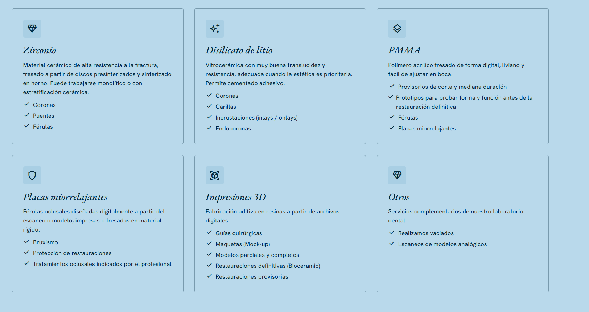
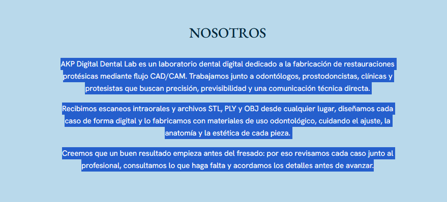
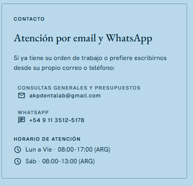
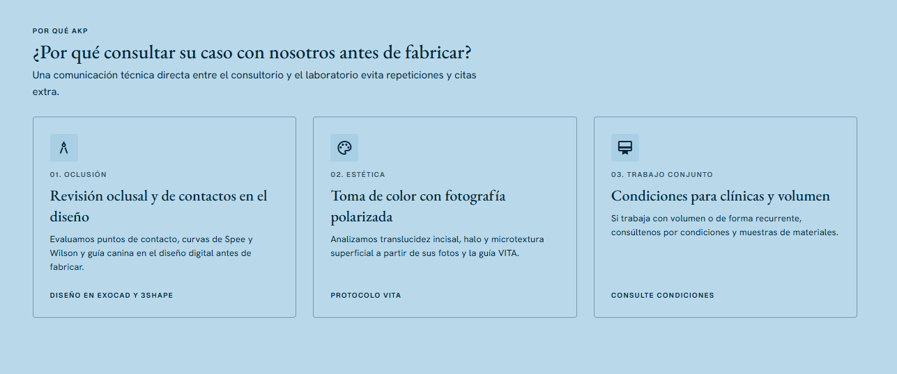
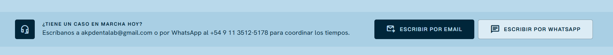
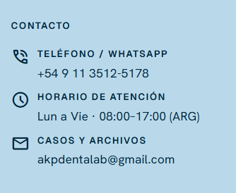

# Cambios solicitados en la web (2)

1. **Fondo de las tarjetas:** todos los recuadros como este deben tener fondo **gris perla** (Pantone Cool Gray 2C — aprox. `#D0D0CE`):

   

2. **Ícono de "Otros":** debe corresponderse con el texto.

3. **Alineación:** este texto debe ir **justificado** (como en Word):

   

4. **Instagram en "Atención":** cambiar a "Atención por email, WhatsApp e Instagram" y agregar el perfil [@akpdentalab](https://www.instagram.com/akpdentalab/) con link directo:

   

5. **Eliminar** esto:

   

6. **Eliminar** esta sección:

   

7. **Horarios y redes:** agregar el horario del **sábado** y el ícono de Instagram con link a [@akpdentalab](https://www.instagram.com/akpdentalab/):

   